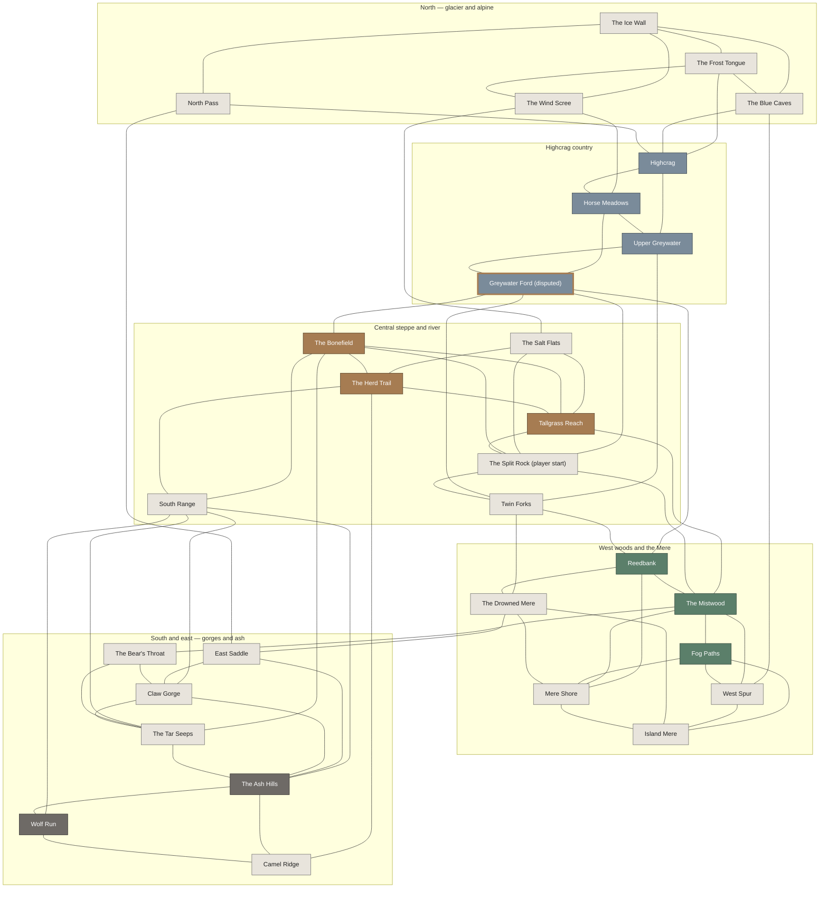

# World map regions draft (Saga, 2026-11-10)

Owner: Saga (region list, lore owners, loner ranges, flavour). Travel cost, danger and claim maths: **Tundra**, for `world-map-territory-v0.1`. Code already in tree: Flint (`src/renderer/data/map.json`, `src/renderer/js/worldmap.js`).
Status: **DRAFT for Tundra.** Uncommitted. Invented nothing. Where sources disagree, the conflict is listed in §6; this draft does not pick a winner except to note existing Director / spec calls already on the page.

Director asked for the region list and graph (regions, what's in each, starting owners from the lore) so Tundra only has to add travel, danger and claim maths. Those three already have a full draft in `map-v1` v1.0.1; this file restates the geography and ownership, and leaves the formulae to Tundra.

**Sources (do not treat this draft as a new source of facts):**

- `docs/design/map-v1.md` v1.0.1 DRAFT (commit `68ef270`, Flint, 2026-11-06 02:13 +02:00). Latest version of the 30-region catalogue, adjacency, start holders, start claims, biomes and hazards.
- `src/renderer/data/map.json` (generated from that spec by `scripts/slice-data-from-specs.js`, `dataVersion` 1, `specVersion` 1.0.1). Adjacency lists and the 69-edge table match the spec exactly (checked).
- `src/renderer/js/worldmap.js` (reads `map.json`; no extra regions or edges).
- `docs/lore/world-and-prides.md` DRAFT v0.1 (10 legacy landmarks and pride territory prose). That doc says: where it and a spec disagree, the spec wins.
- `docs/lore/loners.md` DRAFT v0.1 and `docs/lore/loners.json` (home zones and band shared ground).
- `docs/loners-spec.md` v0.8 §2.1 (home ranges must be in neutral or border land).
- `docs/map-copy.md` (Saga landscape blurbs for all 30 ids; observations, not ownership).

Legacy ids kept so `loners.json` `homeZones` stay valid (`map-v1` header): `ice_wall`, `highcrag`, `bonefield`, `mistwood`, `greywater_ford`, `split_rock`, `drowned_mere`, `tar_seeps`, `bears_throat`, `ash_hills`. The other 20 ids are new in `map-v1` v1.0. Display names in §1 are the working titles from `map-v1` §4.1; Saga may rename strings later without changing ids (`map-v1` §10.4).

The valley's name and spine, from `world-and-prides.md` §1: **Greywater Vale**. The Ice Wall closes the north. The Greywater runs south from its melt, through grass, pine and marsh, and slows into the Drowned Mere. Past the Mere the land rises into the Ash Hills, where the wolves are.

---

## 1. Region catalogue (30)

Prey numbers are 0–3 from `map-v1` §4.1 (`prey` base, then spring / summer / autumn / winter). Qualitative prey and landmarks are included **only** when a source names them. Human camps and hyena dens are not sourced as region features (see §6.8).

Water values follow `map.json`. The spec enum is `none | river | lake | marsh | meltwater` (`map-v1` §4); `tallgrass` is the one exception (`seasonal pool` in the spec table, stored as `pool` — see §6.5). `freezes: yes` means winter drink uses eat-snow (`map-v1` §8.1).

Start-claim numbers are Tundra's existing `map.json` / `map-v1` §10.1 values, copied here as ownership notes, not as a new formula.

| id | Display name | Terrain (biome) | Notable features (sourced only) | Prey by season | Water | Starting owner and claim notes | Sources |
|---|---|---|---|---|---|---|---|
| `ice_wall` | The Ice Wall | Glacier | Glacier face; meltwater caves and blue light; cats say the first sabretooths came out of it. Duskrunner's hook: a pass through the ice lies somewhere here (not mapped to a region in data). | Base 1; spr 1, sum 1, aut 1, win 0. Lore: few prey. | Meltwater, freezes | Neutral (wild). Player-facing loner ground for Greymantle and Duskrunner. | `map-v1` §4.1; `world-and-prides.md` §1; `loners.md` (Duskrunner); `map-copy.md` |
| `frost_tongue` | The Frost Tongue | Glacier | A low tongue of glacier ice toward the foothills; meltwater under a cloudy crust; loose snow above. Thin ice in spring (2%). | Base 1; spr 1, sum 2, aut 1, win 0 | Meltwater, freezes | Neutral (wild). | `map-v1` §4.1; `map-copy.md` |
| `blue_caves` | The Blue Caves | Glacier | Ice hollows with blue light; mouths offer den shelter from the wind (`+Warmth` when resting, `map-v1` note \*). Tier `safe` is for shelter, not hunting. | Base 1; spr 1, sum 1, aut 1, win 1 | Meltwater, freezes | Neutral (wild). | `map-v1` §4.1 note \*; `map-copy.md` |
| `wind_scree` | The Wind Scree | Open tundra | Loose stones, little grass; wind strips scent. | Base 1; spr 1, sum 1, aut 1, win 0 | None | Neutral (wild). | `map-v1` §4.1; `map-copy.md` |
| `north_pass` | North Pass | Alpine / crag | A high gap through the mountains under steep snowfields; long route, avalanche in winter and spring (6%). Not linked in data to Duskrunner's ice pass (see `ice_wall`). | Base 1; spr 1, sum 2, aut 1, win 0 | Meltwater, freezes | Neutral (wild). | `map-v1` §4.1; `map-copy.md` |
| `highcrag` | Highcrag | Alpine / crag | **Core den** of Highcrag Pride. Cliffs and dry caves above the upper river; wind-scoured meadows below; old pride scent on sheltered stone. Lore: the best dens in the Vale. | Base 2; spr 2, sum 2, aut 2, win 1. Lore: horses and bison on the high meadows (see also `horse_meadows`). | River, does not freeze | Highcrag Pride. Start claim 80. | `map-v1` §4.1–4.2, §10.1; `world-and-prides.md` §1–2.1; `map-copy.md` |
| `horse_meadows` | Horse Meadows | Alpine / crag | Wind-swept meadows above the river; low folds for ambush. Winter wolf pressure (1%). Matches Highcrag lore's "high meadows". | Base 2; spr 3, sum 3, aut 2, win 1. Map-copy and lore: horses (and Highcrag bison on the meadows). | Meltwater, freezes | Highcrag Pride. Start claim 70. | `map-v1` §4.1–4.2, §10.1; `world-and-prides.md` §2.1; `map-copy.md` |
| `upper_greywater` | Upper Greywater | River corridor | Fast upper river between stony banks; hoofprints in the shallows; spring flood (3%). Matches Highcrag lore's "above the upper river". | Base 2; spr 3, sum 2, aut 2, win 2. Map-copy: hoofprints (drinkers). | River, does not freeze | Highcrag Pride. Start claim 65. | `map-v1` §4.1–4.2, §10.1; `world-and-prides.md` §2.1; `map-copy.md` |
| `greywater_ford` | Greywater Ford | River corridor | Shallow crossing; the river keeps moving in winter. Good ambush ground. Rival scent on the banks. Spring flood (2%); wolves 2% year-round. | Base 3; spr 3, sum 3, aut 3, win 2. Lore and map-copy: horses come to drink. | River, does not freeze | **Held by Highcrag, disputed by Bonefield from day 1.** Start claims: Highcrag 55, Bonefield 45. Sorrel's home zone (border land). | `map-v1` §4.1 note †, §4.2, §10.1; `world-and-prides.md` §1–2.1; `loners.json`; `map-copy.md` |
| `salt_flats` | The Salt Flats | Open tundra | Pale crust, sparse grass; tracks easy, fresh water and prey hard. | Base 1; spr 1, sum 1, aut 1, win 0 | None | Neutral (wild). | `map-v1` §4.1; `map-copy.md` |
| `bonefield` | The Bonefield | Grassland / steppe | **Core den** of Bonefield Pride. Wide open grass in the middle of the Vale, littered with old mammoth bones; little cover. Winter wolves (2%). | Base 3; spr 3, sum 3, aut 2, win 1. Lore: the herds pass through every season. | None | Bonefield Pride. Start claim 80. | `map-v1` §4.1–4.2, §10.1; `world-and-prides.md` §1–2.2; `map-copy.md` |
| `herd_trail` | The Herd Trail | Grassland / steppe | A broad trail worn by generations of hooves; wolves follow the same route (3% year-round); winter scarcity (2%). | Base 2; spr 3, sum 3, aut 3, win 1. Map-copy: herd scent. | None | Bonefield Pride. Start claim 70. Not named as its own holding in lore (see §6.3). | `map-v1` §4.1–4.2, §10.1; `map-copy.md` |
| `tallgrass` | Tallgrass Reach | Grassland / steppe | Tall grass over narrow trails, broken by shallow seasonal pools. No listed hazards. | Base 2; spr 2, sum 2, aut 2, win 1 | Seasonal pool (`pool` in `map.json`), freezes | Bonefield Pride. Start claim 65. Not named as its own holding in lore (see §6.3). | `map-v1` §4.1–4.2, §10.1; `map-copy.md` |
| `south_range` | South Range | Grassland / steppe | Open grass rolling toward the dry southern hills. Wolves 3%; bear 1%. Wolf-pressured in the faction notes (`map-v1` §4.2). | Base 2; spr 2, sum 2, aut 2, win 1. Map-copy: prey to follow. | None | Neutral (wild). Bonefield is written as an aggressive expander toward the ford and this region. | `map-v1` §4.1–4.2; `map-copy.md` |
| `split_rock` | The Split Rock | Grassland / steppe | A cracked boulder the height of ten cats; old meeting place; scent marks from every pride; no pride claims it. Default **player start**. No listed hazards. | Base 2; spr 2, sum 2, aut 2, win 1 | None | Neutral (wild). Shared loner ground (see §4). | `map-v1` §4.1–4.2, §8.5, tunables; `world-and-prides.md` §1; `loners.json`; `map-copy.md` |
| `twin_forks` | Twin Forks | River corridor | Two channels of the Greywater meet among low banks and wet grass; spring flood (3%). A authored cave-hyena *encounter* is set "at the forks"; that is not a hyena den landmark (see §6.8). | Base 2; spr 3, sum 2, aut 2, win 2. Map-copy: prey comes to drink. | River, does not freeze | Neutral (wild). | `map-v1` §4.1; `map-copy.md`; `encounters-v0.2.json` opening line only |
| `reedbank` | Reedbank | Marsh / reed | Thick reeds at the marsh edge; soft ground; spring flood (2%). | Base 2; spr 3, sum 3, aut 2, win 1. Map-copy: geese. Biome note: mosquitoes in summer; geese spring–summer. | Marsh, does not freeze | Mistwood Pride. Start claim 65. Not named as its own holding in lore (see §6.3). | `map-v1` §3, §4.1–4.2, §10.1; `map-copy.md` |
| `mistwood` | The Mistwood | Pine forest | **Core den** of Mistwood Pride, though they move between hidden dens and never sleep long in one place. Pine and fog marsh along the lake; narrow trails; 1% lost_trail. | Base 2; spr 2, sum 2, aut 2, win 1. Lore: deer and geese. | Marsh, does not freeze | Mistwood Pride. Start claim 80. | `map-v1` §4.1–4.2, §10.1; `world-and-prides.md` §1–2.3; `map-copy.md` |
| `fog_paths` | Fog Paths | Pine forest | Narrow tracks through pines and wet hollows; fog hides the turn (lost_trail 3%). | Base 2; spr 2, sum 2, aut 1, win 1 | Marsh, does not freeze | Mistwood Pride. Start claim 70. Not named as its own holding in lore (see §6.3). | `map-v1` §4.1–4.2, §10.1; `map-copy.md` |
| `west_spur` | West Spur | Pine forest | A wooded rise on the western edge of the Vale; dry pockets among pine roots. Optional 2-day mountain skirt around Highcrag to `blue_caves` (`map-v1` note ‡). Spec table lists an unnamed 1% hazard; `map.json` has none (see §6.4). | Base 2; spr 2, sum 2, aut 2, win 1 | None | Neutral (wild). | `map-v1` §4.1 note ‡; `map.json`; `map-copy.md` |
| `drowned_mere` | The Drowned Mere | Lake shore | The lake itself. Reeds and shallows; ice in winter; in spring the ice can hold its shape after it has lost its strength (**the Breaking**: Longshadow led Mistwood across to the far shore for deer; cats drowned, were swept, or were stranded). Thin ice 8% spring, 2% winter on the ice. Lore table still calls this a Mistwood border; the current spec does not (see §6.1). | Base 2; spr 3, sum 2, aut 1, win 1. Lore and map-copy: geese. | Lake, freezes | Neutral (wild). Soft Mistwood influence via adjacent claims, not ownership (`map-v1` note §). Home zone for Lichen, Sedge and Coldwater (see §6.2). | `map-v1` §4.1 note §; `world-and-prides.md` §1–2.3; `loners.json`; `map-copy.md` |
| `mere_shore` | Mere Shore | Lake shore | Reeds across old paw-worn trails beside the lake; spring ice weakens along the shore (thin ice 3%). `map-v1` §4.2: starts wild, lost in the Breaking; Mistwood's first reclaim target. Director (2026-11-06): starts wild, contestable from day 1. | Base 2; spr 3, sum 3, aut 2, win 1. Map-copy: open water draws prey. | Lake, freezes | Neutral (wild). No start claim. | `map-v1` §4.1–4.2, §13; `map-copy.md` |
| `island_mere` | Island Mere | Marsh / reed | Low islands breaking the Mere into reed-fringed channels; shallows that change with the water. Thin ice 4% spring; flood 2% with no season tag in data (see §5). | Base 2; spr 3, sum 2, aut 2, win 1. Map-copy: geese among the islands. | Lake, freezes | Neutral (wild). | `map-v1` §4.1; `map.json`; `map-copy.md` |
| `east_saddle` | East Saddle | Alpine / crag | Exposed saddle linking the heights above the lake and the southern hills; loose rock and steep snowfields; avalanche 3%, rockfall 2%. The `drowned_mere`–`east_saddle` and `east_saddle`–`ash_hills` legs are 2-day edges. | Base 1; spr 2, sum 2, aut 1, win 0 | Meltwater, freezes | Neutral (wild). | `map-v1` §4.1, §5.4; `map-copy.md` |
| `bears_throat` | The Bear's Throat | Gorge / canyon | A narrow gorge. **A short-faced bear dens here**; claw marks score the rock beside the den. Bear 12%, rockfall 3%. | Base 1; spr 1, sum 1, aut 1, win 1. Lore: the bear takes any carcass it smells; Torncheek and Nettle use the leavings. | None | Neutral (wild). Shared loner / band ground (Torncheek, Nettle, Ashfall; the Broken Wandering). | `map-v1` §4.1; `world-and-prides.md` §1; `loners.md`; `map-copy.md` |
| `claw_gorge` | Claw Gorge | Gorge / canyon | Narrow ledges between walls scored by bear claws; little room to turn. Bear 5%, rockfall 2%. | Base 1; spr 1, sum 2, aut 1, win 1 | None | Neutral (wild). | `map-v1` §4.1; `map-copy.md` |
| `tar_seeps` | The Tar Seeps | Tar seeps | Black pools that trap the careless; trapped prey draws every hunter; the ground gives underfoot. Tar is undrinkable. Tar trap 10%; wolves 2%. | Base 2; spr 2, sum 2, aut 2, win 2. Lore and map-copy: scavenging / trapped prey (a bison bogged here is a band-story beat). | None (tar undrinkable) | Neutral (wild). Wolf-pressured in the faction notes (`map-v1` §4.2). Home zone for Torncheek and Lichen. | `map-v1` §3, §4.1–4.2; `world-and-prides.md` §1; `loners.md`; `map-copy.md` |
| `ash_hills` | The Ash Hills | Dry ash hills | **Core den** of the dire-wolf pack (not a playable pride). Dry southern hills; wolf tracks and scent marks on the ridges. | Base 2; spr 1, sum 3, aut 2, win 1. Lore and map-copy: camels in summer. | None | Dire wolves. Start claim 75. v1: static holder, scent pressure and hazards only; never expands or retreats (`activeAI: false`). Ashfall's `homeZones` lists this id (see §6.6). | `map-v1` §4.1–4.2, §9.6, §10.1, §13; `world-and-prides.md` §1; `loners.json`; `map-copy.md` |
| `wolf_run` | Wolf Run | Dry ash hills | A hard-worn trail in dry wolf country; fresh prints overlap the old; scent marks on the stones. Wolves 14%. | Base 1; spr 1, sum 2, aut 1, win 1 | None | Dire wolves. Start claim 70. Static in v1, same as `ash_hills`. | `map-v1` §4.1–4.2, §10.1; `map-copy.md` |
| `camel_ridge` | Camel Ridge | Dry ash hills | Camel trails on the dry ridge toward summer grazing; water scarce; wolf scent from the neighbouring hills. Wolves 6%; winter scarcity 3%. | Base 1; spr 1, sum 3, aut 2, win 0. Lore (Ash Hills / southern slopes) and map-copy: camels in summer. | None | Neutral (wild) but wolf-pressured (`pressureFaction: wolves`, `map-v1` note ¶). | `map-v1` §4.1 note ¶; `world-and-prides.md` §1 (camels on the dry southern slopes); `map-copy.md` |

### 1.1 Starting pride and faction territories

From `map-v1` §4.2 and `startClaims` in `map.json`. Temperament lines are lore colour for Tundra, not new rules (`world-and-prides.md` §2; `map-v1` §9.6 lean).

| Pride / faction | Core den | Starting claimed regions | Notes |
|---|---|---|---|
| Highcrag Pride | `highcrag` | `highcrag` (80), `horse_meadows` (70), `upper_greywater` (65), `greywater_ford` (55, disputed) | Traditional, defensive. Won't expand fast. Lore: "We were here first." They claim the Ford; Bonefield disputes it. |
| Bonefield Pride | `bonefield` | `bonefield` (80), `herd_trail` (70), `tallgrass` (65); disputes `greywater_ford` (45) | Aggressive expander toward the ford and `south_range`. |
| Mistwood Pride | `mistwood` | `mistwood` (80), `fog_paths` (70), `reedbank` (65) | Smallest; cautious. `mere_shore` starts wild (lost in the Breaking) and is its first reclaim target. |
| Dire wolves (faction) | `ash_hills` | `ash_hills` (75), `wolf_run` (70) | Not a playable pride. Pressure on `camel_ridge`, `south_range`, `tar_seeps`. **v1: static holder.** |
| Player start | — | none | Starts at `split_rock` as a loner (world-gen may override). |

Neutral at start (18): `ice_wall`, `frost_tongue`, `blue_caves`, `wind_scree`, `north_pass`, `salt_flats`, `south_range`, `split_rock`, `twin_forks`, `west_spur`, `drowned_mere`, `mere_shore`, `island_mere`, `east_saddle`, `bears_throat`, `claw_gorge`, `tar_seeps`, `camel_ridge`.

Overlay colours already in `map.json` (for Ochre / Flint, and for the graph in §3): Highcrag `#7A8B9A`, Bonefield `#A67C52`, Mistwood `#5B7F6A`, player `#C4A35A`, wolves `#6E6A66`, neutral transparent.

---

## 2. Adjacency (sourced, not proposed)

**Source:** `map-v1` §5.4 edge list and the matching `map.json` `edges` / per-region `adjacency` arrays. `worldmap.js` builds the undirected graph from those edges; it does not add any. A check of all 30 adjacency lists against the 69 edges found **no mismatches**.

Travel is only to an adjacent region. Days and `winterDays` below are Tundra's existing v1.0.1 figures, copied so the graph is complete. Tundra may retune them in `world-map-territory-v0.1`; this draft does not propose new costs or a formula.

Everything is reachable. `map-v1` §5: longest home-to-home pride trip is about 3 hops. Notable long legs already in the table: `ice_wall`–`north_pass`, `blue_caves`–`west_spur` (the mountain skirt), `north_pass`–`east_saddle`, `salt_flats`–`herd_trail`, `drowned_mere`–`east_saddle`, `east_saddle`–`ash_hills` (all 2 days, some longer in winter); `south_range`–`ash_hills` stays 1 day but rises to 2 in winter; `west_spur`–`island_mere` and `drowned_mere`–`island_mere` rise to 2 days in winter.

| a | b | days | winterDays |
|---|---|---|---|
| ice_wall | frost_tongue | 1 | 2 |
| ice_wall | blue_caves | 1 | 2 |
| ice_wall | wind_scree | 1 | 2 |
| ice_wall | north_pass | 2 | 3 |
| frost_tongue | blue_caves | 1 | 2 |
| frost_tongue | highcrag | 1 | 2 |
| frost_tongue | wind_scree | 1 | 1 |
| blue_caves | highcrag | 1 | 1 |
| blue_caves | west_spur | 2 | 3 |
| wind_scree | horse_meadows | 1 | 1 |
| wind_scree | salt_flats | 1 | 1 |
| north_pass | highcrag | 1 | 2 |
| north_pass | east_saddle | 2 | 3 |
| highcrag | horse_meadows | 1 | 1 |
| highcrag | upper_greywater | 1 | 1 |
| horse_meadows | upper_greywater | 1 | 1 |
| horse_meadows | greywater_ford | 1 | 1 |
| upper_greywater | greywater_ford | 1 | 1 |
| upper_greywater | twin_forks | 1 | 1 |
| greywater_ford | bonefield | 1 | 1 |
| greywater_ford | twin_forks | 1 | 1 |
| greywater_ford | split_rock | 1 | 1 |
| greywater_ford | reedbank | 1 | 1 |
| salt_flats | tallgrass | 1 | 1 |
| salt_flats | split_rock | 1 | 1 |
| salt_flats | herd_trail | 2 | 2 |
| bonefield | herd_trail | 1 | 1 |
| bonefield | tallgrass | 1 | 1 |
| bonefield | south_range | 1 | 1 |
| bonefield | split_rock | 1 | 1 |
| bonefield | tar_seeps | 1 | 1 |
| herd_trail | tallgrass | 1 | 1 |
| herd_trail | south_range | 1 | 1 |
| herd_trail | camel_ridge | 1 | 1 |
| tallgrass | split_rock | 1 | 1 |
| tallgrass | mistwood | 1 | 1 |
| south_range | tar_seeps | 1 | 1 |
| south_range | claw_gorge | 1 | 1 |
| south_range | ash_hills | 1 | 2 |
| south_range | wolf_run | 1 | 1 |
| split_rock | mistwood | 1 | 1 |
| split_rock | twin_forks | 1 | 1 |
| twin_forks | reedbank | 1 | 1 |
| twin_forks | drowned_mere | 1 | 1 |
| reedbank | mistwood | 1 | 1 |
| reedbank | drowned_mere | 1 | 1 |
| reedbank | mere_shore | 1 | 1 |
| mistwood | fog_paths | 1 | 1 |
| mistwood | west_spur | 1 | 1 |
| mistwood | mere_shore | 1 | 1 |
| mistwood | bears_throat | 1 | 1 |
| fog_paths | west_spur | 1 | 1 |
| fog_paths | mere_shore | 1 | 1 |
| fog_paths | island_mere | 1 | 1 |
| west_spur | island_mere | 1 | 2 |
| drowned_mere | mere_shore | 1 | 1 |
| drowned_mere | island_mere | 1 | 2 |
| drowned_mere | east_saddle | 2 | 2 |
| mere_shore | island_mere | 1 | 1 |
| east_saddle | claw_gorge | 1 | 1 |
| east_saddle | ash_hills | 2 | 2 |
| bears_throat | claw_gorge | 1 | 1 |
| bears_throat | tar_seeps | 1 | 1 |
| claw_gorge | tar_seeps | 1 | 1 |
| claw_gorge | ash_hills | 1 | 1 |
| tar_seeps | ash_hills | 1 | 1 |
| ash_hills | wolf_run | 1 | 1 |
| ash_hills | camel_ridge | 1 | 1 |
| wolf_run | camel_ridge | 1 | 1 |

Neighbour lists (same graph, for lookup):

- `ice_wall`: frost_tongue, blue_caves, wind_scree, north_pass
- `frost_tongue`: ice_wall, blue_caves, highcrag, wind_scree
- `blue_caves`: ice_wall, frost_tongue, highcrag, west_spur
- `wind_scree`: ice_wall, frost_tongue, horse_meadows, salt_flats
- `north_pass`: ice_wall, highcrag, east_saddle
- `highcrag`: frost_tongue, blue_caves, horse_meadows, upper_greywater, north_pass
- `horse_meadows`: highcrag, wind_scree, upper_greywater, greywater_ford
- `upper_greywater`: highcrag, horse_meadows, greywater_ford, twin_forks
- `greywater_ford`: horse_meadows, upper_greywater, bonefield, twin_forks, split_rock, reedbank
- `salt_flats`: wind_scree, tallgrass, split_rock, herd_trail
- `bonefield`: greywater_ford, herd_trail, tallgrass, south_range, split_rock, tar_seeps
- `herd_trail`: bonefield, salt_flats, tallgrass, south_range, camel_ridge
- `tallgrass`: salt_flats, bonefield, herd_trail, split_rock, mistwood
- `south_range`: bonefield, herd_trail, tar_seeps, claw_gorge, ash_hills, wolf_run
- `split_rock`: greywater_ford, bonefield, tallgrass, salt_flats, mistwood, twin_forks
- `twin_forks`: upper_greywater, greywater_ford, split_rock, reedbank, drowned_mere
- `reedbank`: greywater_ford, twin_forks, mistwood, drowned_mere, mere_shore
- `mistwood`: tallgrass, split_rock, reedbank, fog_paths, west_spur, mere_shore, bears_throat
- `fog_paths`: mistwood, west_spur, mere_shore, island_mere
- `west_spur`: mistwood, fog_paths, island_mere, blue_caves
- `drowned_mere`: twin_forks, reedbank, mere_shore, island_mere, east_saddle
- `mere_shore`: reedbank, mistwood, fog_paths, drowned_mere, island_mere
- `island_mere`: fog_paths, west_spur, drowned_mere, mere_shore
- `east_saddle`: north_pass, drowned_mere, claw_gorge, ash_hills
- `bears_throat`: mistwood, claw_gorge, tar_seeps
- `claw_gorge`: south_range, bears_throat, tar_seeps, ash_hills, east_saddle
- `tar_seeps`: bonefield, south_range, bears_throat, claw_gorge, ash_hills
- `ash_hills`: south_range, claw_gorge, east_saddle, wolf_run, camel_ridge, tar_seeps
- `wolf_run`: ash_hills, camel_ridge, south_range
- `camel_ridge`: herd_trail, ash_hills, wolf_run

---

## 3. Mermaid graph (coloured by starting owner)

Colours are the `overlay.factionColors` from `map.json`, except neutral, which is transparent in data and is shown here as stone `#E8E4DC` so the nodes stay readable. `greywater_ford` is filled Highcrag with a Bonefield stroke (held, disputed). Layout is geographic: north at the top, Ash Hills at the bottom, Mistwood and the Mere to the west, the steppe in the middle. Edges are the sourced §2 graph.

---

## 4. Loner home zones and band locations

From `loners.md` and `loners.json` (kept in sync). Range ids were chosen from the legacy 10-zone list so they would stay valid when the map grew (`map-v1` header). `loners-spec.md` §2.1: 1–2 home zones in **neutral or border** land; a loner never holds a claimed territory. `loners.md` open points: draft home zones were already moved so no loner lives in claimed land (Coldwater off the Mistwood edge to the Split Rock; Torncheek off Greywater Ford to the Bear's Throat).

Bands do not start placed on the map. `loners-spec.md` §5b.2: a band can form when two or more adult male loners share a home zone. Story labels below are from `loners.md` (draft names only). A wandering holds no land and keeps no den (`loners.md`; Highcrag pretends they do not exist).

### 4.1 The nine loners

| Loner | Origin / departure | Home zones (`loners.json`) | Prose range (`loners.md` / json `range`) | Notes |
|---|---|---|---|---|
| Greymantle | Highcrag, exiled | `split_rock`, `ice_wall` | The Split Rock and the lower slope of the Ice Wall, within sight of the crag | Elder; solitary, does not band |
| Sorrel | Highcrag, left | `greywater_ford`, `split_rock` | Greywater Ford and the Split Rock | Ford is border land (held + disputed), which fits §2.1 "border" |
| Torncheek | Bonefield, exiled | `tar_seeps`, `bears_throat` | The Tar Seeps and the Bear's Throat, just outside Bonefield land | Shared ground for the Broken Wandering |
| Nettle | Bonefield, left | `bears_throat`, `split_rock` | The Bear's Throat and the Split Rock | Not afraid of the bear; female, never joins a wandering |
| Duskrunner | Bonefield, left | `ice_wall`, `split_rock` | The foot of the Ice Wall and the Split Rock | Shared ground for the Long Way Home; he has found a pass through the ice (not given a region id) |
| Lichen | Mistwood, survivor | `tar_seeps`, `drowned_mere` | The Tar Seeps and the southern / south shore of the Drowned Mere | Swept downriver to near the Tar Seeps in the Breaking. Shore id may need a look after the 30-region split (see §6.2) |
| Ashfall | Mistwood, exiled | `ash_hills`, `bears_throat` | The edge of the Ash Hills and the Bear's Throat | "He lives where no cat wants to." `ash_hills` is wolf-held, which sits against §2.1 (see §6.6) |
| Sedge | Mistwood, left | `drowned_mere` | The shore of the Drowned Mere | Walks the river looking for her lost cubs. Only one home zone |
| Coldwater | Mistwood, survivor | `drowned_mere`, `split_rock` | The north shore of the Drowned Mere and the Split Rock | Stranded on the far bank in the Breaking; now at the marsh edge. Shore id: see §6.2 |

### 4.2 Plausible bands (`loners.md`)

| Band (draft story name) | Members | Shared zone at start | Why it is listed |
|---|---|---|---|
| The Broken Wandering | Torncheek + Ashfall | `bears_throat` | Shared home zone in data |
| The Long Way Home | Coldwater + Duskrunner | `split_rock` | Shared home zone in data |
| Possible third pairing | Torncheek + Duskrunner | none at start | Half-brothers; very unlikely without a shared zone and a reason |
| Unlikely | Coldwater + Ashfall | none | Both from Mistwood; story reasons they would not band |

The Broken Wandering would target Bonefield; the Long Way Home would target Mistwood. Either could turn on a weak player pride. That is story, under Tundra's §5b rules.

---

## 5. Gaps for Tundra

Travel cost, danger and claim are Tundra's. This draft does not write or retune formulae. The items below are what still need a decision or a pass in `world-map-territory-v0.1`.

1. **Travel, danger and claim maths.** `map-v1` already has edge days, hazard percentages, derived danger bands, claim / upkeep / skirmish / AI expand-and-retreat, and an early-loner shield. Carry or retune those in the new spec; do not treat this file as a numbers source.
2. **Pass bands** Tracker asked for: the largest share any one pride should hold over many seasons, how often regions should change hands, and the most seasons a pride can sit with no change. (`map-v1` §12 has older balance targets, including the Ford staying contested and Mistwood reclaiming `mere_shore`.)
3. **`west_spur` unnamed 1% hazard** (`map-v1` §4.1 vs empty `hazards` in `map.json`). Name it or drop it.
4. **Water enum.** `tallgrass` is `seasonal pool` in the spec table and `pool` in `map.json`, which is not in `none | river | lake | marsh | meltwater`. Either extend the enum or remap it.
5. **`island_mere` flood 2%** has no season tag in data; other flood rows are spring-only. Confirm whether that is intentional.
6. **Conflicts in §6**, especially `drowned_mere` ownership prose, shore loners vs `mere_shore` / `island_mere`, and Ashfall's `ash_hills` home zone. Saga will follow Tundra's call and, if needed, retune loner ids or lore lines after sign-off.
7. **Qualitative prey** (horses, bison, geese, camels, and so on) lives in lore and `map-copy.md` only. `map.json` stores 0–3 values. Say whether arrival prose and hunt text may keep using the named prey, or whether that needs a data field.
8. **Human camps and hyena dens** were examples in Director's brief. They are not in the region catalogue or the lore landmark table. This draft does not add them. A cave-hyena *encounter* is authored "at the forks" (`encounter.cave_hyena.v1`); that is an event, not a den feature.

---

## 6. Conflicts and tensions

No new regions or owners were invented to paper these over.

### 6.1 `drowned_mere` ownership — lore vs current spec

- `world-and-prides.md` §1 table: held by "Border (Mistwood)".
- The lean `map-v1` v0.1 bak said the same: "border: Mistwood".
- `map-v1` v1.0.1 note §, §4.2 and §13 (Director, 2026-11-06): `drowned_mere` is **neutral**; Mistwood has soft influence via adjacent claims, not ownership. `mere_shore` starts wild, contestable from day 1.

Lore itself says the spec wins. The current start holder is neutral. The pride doc still needs a line update so "Border (Mistwood)" does not fight the map.

### 6.2 Shores of the Mere after the 30-region split

The lake was one legacy zone (`drowned_mere`). It is now three: `drowned_mere`, `mere_shore`, `island_mere`.

- `map-v1` §4.2 ties **`mere_shore`** to the Breaking: it starts wild, "lost in the Breaking", and is Mistwood's first reclaim target. Map-copy mentions old paw-worn trails beside the lake.
- Lore: Longshadow led the pride across the Mere to the **far shore** for deer; Coldwater was stranded on the **far bank**; Lichen's range is the **southern / south shore**; Coldwater's is the **north shore**; Sedge walks "**the shore**".
- `loners.json` still maps all three shore loners to **`drowned_mere`**, not to `mere_shore` or `island_mere`.

This draft does not reassign those home zones. Tundra and Saga should decide whether "south shore", "north shore" and "far shore" stay as flavour on the lake id, or move onto the new shore regions.

### 6.3 Pride territory is coarser in lore than on the 30-region map

Not a hard contradiction if the new regions are read as splits of the old holdings, but the pride doc does not name the extra ids:

- Highcrag lore: "Highcrag, the cliffs and caves above the upper river, and the high meadows", plus a claim on Greywater Ford. The map's `horse_meadows` and `upper_greywater` fit that prose.
- Bonefield lore: "the Bonefield, the open grassland… where the herds pass", and a dispute at the Ford. The map also starts them with `herd_trail` and `tallgrass`.
- Mistwood lore: "the Mistwood, the pine forest and fog marsh along the Drowned Mere." The map also starts them with `fog_paths` and `reedbank`.

### 6.4 `west_spur` hazards — spec table vs code

`map-v1` §4.1: "— (1%)" with no hazard id. `scripts/slice-data-from-specs.js` documents that an unnamed `— (1%)` becomes an empty list, so `map.json` has `hazards: []`.

### 6.5 `tallgrass` water value — spec enum vs stored value

Spec table: "seasonal pool". Spec enum in §4: no `pool`. Generator writes `"water": "pool"`. `worldmap.js` treats any water other than `none` as drinkable (unless frozen).

### 6.6 Ashfall's home zone on wolf-held land

- `loners-spec.md` §2.1 and `loners.md`: home zones in neutral or border land; zones were moved so no loner lives in claimed land.
- `loners.md` / `loners.json`: Ashfall's range is "the edge of the Ash Hills and the Bear's Throat", stored as `ash_hills` + `bears_throat`.
- `map-v1`: `ash_hills` is the wolves' core den, start claim 75, holder `wolves`.

"The edge of" may have been meant as a neighbouring wild region (`south_range`, `camel_ridge`, `claw_gorge` or `tar_seeps`), but the stored id is the held core itself. This tension already existed on the 10-zone map, where `ash_hills` was wolf country. This draft does not move him.

### 6.7 Greywater Ford as a loner home (Sorrel) — probably fine

The Ford is held and disputed, not wild. Spec §2.1 allows **border** land, and the lore table already called the Ford a Highcrag / Bonefield border. Torncheek was deliberately moved *off* the Ford; Sorrel was left on it. Flagging only so the border reading is explicit.

### 6.8 Features mentioned in the Director brief that are not in the sources

- **Human camps:** no region, lore landmark, or map-copy line places a human camp. Encounter art notes a possible human encounter as a future threat; that is not a map feature.
- **Hyena dens:** no region is sourced as having a hyena den. `encounter.cave_hyena.v1` opens "at the forks" (a Highcrag hunter's carcass), which is an event hook at `twin_forks`, not a den.

### 6.9 Older 10-zone adjacency is superseded

`map-v1.v0.1.bak.md` had a 13-edge graph over the 10 legacy ids (for example a direct `highcrag`–`split_rock` hop, and `bonefield`–`ash_hills` in 2 days). The current 30-region graph replaces that. Several legacy pairs are no longer direct neighbours (`ice_wall`–`highcrag`, `highcrag`–`greywater_ford`, `highcrag`–`split_rock`, `highcrag`–`bears_throat`, `greywater_ford`–`drowned_mere`, `bonefield`–`ash_hills`, `mistwood`–`drowned_mere`). Code uses only the 30-region graph. Called out so no one rebuilds from the lean draft by mistake.

---

## Changelog

- 2026-11-10, Saga: first draft of the region list and sourced graph for Tundra's `world-map-territory-v0.1`. 30 regions, 69 sourced edges, start owners from `map-v1` plus lore notes, loner and band locations, conflict list. Uncommitted. No travel / danger / claim formulae.
